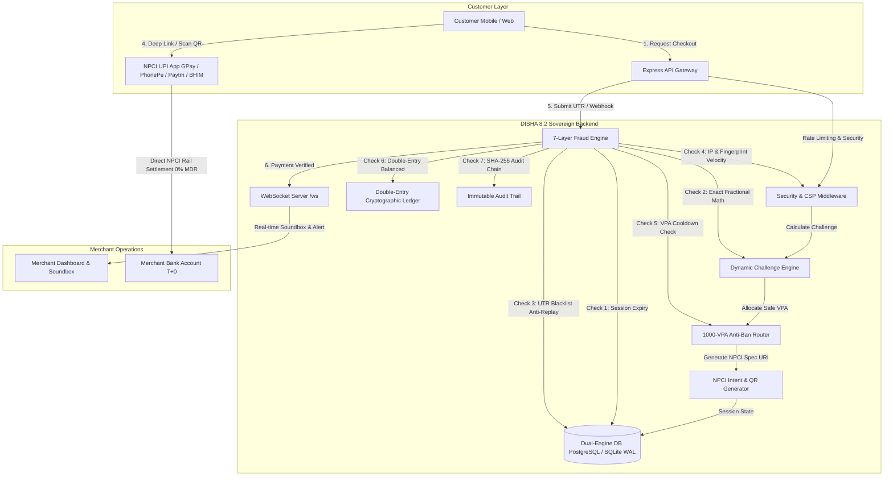
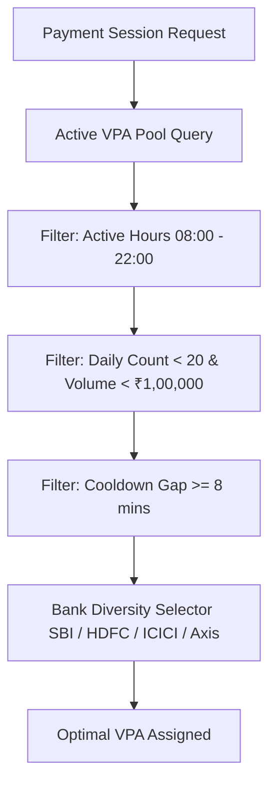

# DISHA 8.2 — End-to-End Backend Architecture & System Specifications

> **Classification:** Production Architecture Specification  
> **System:** DISHA 8.2 Sovereign Zero-Trust Payment Infrastructure  
> **Repository:** `Zero-Trust-Fintech`  
> **Version:** 8.2.0-Production  
> **License:** Business Source License 1.1 (BSL 1.1)

---

## 1. Executive Architecture Overview

DISHA 8.2 replaces traditional third-party payment aggregator models (e.g., Razorpay, Cashfree, PayU) that charge **1.8% – 2.5% MDR fees** and subject merchants to **T+2 holding periods**, **chargeback freezes**, and **counterparty risk**. 

Instead, DISHA operates as a **sovereign, self-hosted, zero-trust gateway** running on merchant-controlled infrastructure. Payments flow **directly peer-to-peer (P2P/P2M)** across NPCI UPI rails from customer bank accounts to merchant bank accounts, delivering:
1. **0% Transaction Fees (Save ₹2,000–₹25,000+ per ₹10 Lakhs processed)**.
2. **Instant Settlement (T+0, 0-second latency direct to bank)**.
3. **Cryptographic Double-Entry Ledger Protection**.
4. **Mathematical Anti-Replay Protection via Dynamic Fractional Challenges**.
5. **1,000-VPA Anti-Ban Routing Engine**.
6. **7-Layer Fraud Detection & Prevention Engine**.



---

## 2. Repository File Topology & Architecture Mapping

```
Zero-Trust-Fintech/
├── server.js                        # Unified Root Server: Express, WebSockets, Routing & Middleware
├── db.js                            # Dual-Engine Store (Postgres with SQLite WAL Fallback)
├── vpa-router.js                    # 1000-VPA Anti-Ban Rotation Engine & Quota Tracker
├── vpa-importer.js                  # Bulk VPA CSV / Excel Importer & Validator
├── npci-intent.js                   # NPCI Standard URI Spec Parser & Validator
├── test-disha.js                    # Core Security Engine & Double-Entry Test Suite
├── middleware/
│   └── ip-whitelist.js              # CIDR & IP Whitelisting Middleware
├── routes/
│   └── admin/
│       └── ip-whitelist.js          # Admin IP Whitelist Management Routes
├── utils/
│   ├── upi-intent.js                # NPCI Intent URI Builder & App Deep Links
│   └── trust-score.js               # Multi-factor Fraud Evidence Scoring Engine
├── disha-cinematic/
│   ├── server.js                    # Merchant Auth, API Keys, Telemetry & Dashboard Proxy
│   ├── public/
│   │   ├── index.html               # PhonePe-Inspired Marketing & Customer Presentation
│   │   ├── phonepe-inspired.css     # Production CSS Architecture
│   │   ├── phonepe-inspired.js      # Interactive Slider, Calculator, Video & State Sync
│   │   └── assets/                  # High-Res Logos, Transparent Emblems, Cartoons
│   └── screenshots/                 # Automated Visual Regression Breakpoint Captures
├── public/                          # Customer Checkout PWA Client (HTML/JS/PWA Manifest)
└── disha-ui/                        # React Frontend & Component Architecture
```

---

## 3. End-to-End Payment Lifecycle

```mermaid
sequenceDiagram
    autonumber
    actor Customer
    participant CheckoutUI as Checkout / PWA
    participant Backend as DISHA 8.2 Server
    participant VPARouter as VPA Router Engine
    participant BankRails as NPCI UPI Rails
    actor Merchant as Merchant Soundbox

    Customer->>CheckoutUI: Initiates Checkout (Amount ₹500)
    CheckoutUI->>Backend: POST /api/checkout/create-session
    Backend->>VPARouter: Request Optimal VPA (Bank Diversity & Cooldown)
    VPARouter-->>Backend: Assigned VPA: "meera.nair@okhdfcbank"
    Backend->>Backend: Generate Mathematical Challenge: ₹500.82
    Backend->>Backend: Generate NPCI Intent String & QR Code
    Backend-->>CheckoutUI: Return Session ID, QR Data URL, Intent Link
    Customer->>BankRails: Scan QR / Click Intent via GPay, PhonePe, Paytm
    BankRails-->>Customer: Bank Pin Verified; Transfer Completed
    Customer->>CheckoutUI: Submit Bank 12-Digit UTR (or Auto-captured)
    CheckoutUI->>Backend: POST /api/checkout/verify-utr { sessionId, utr }
    Backend->>Backend: Execute 7-Layer Fraud Verification Engine
    Backend->>Backend: Commit Double-Entry Ledger (Debit Clearing, Credit Settlement)
    Backend->>Backend: Record SHA-256 Audit Log Entry
    Backend-->>Merchant: Broadcast Verified Payment via WebSocket (/ws)
    Backend-->>CheckoutUI: Verification Success (Redirect /success.html)
```

---

## 4. Mathematical Anti-Replay & Dynamic Challenge Engine

To prevent man-in-the-middle attacks, screenshot falsification, and payment replay attacks without relying on expensive gateway webhooks, DISHA 8.2 implements **Mathematical Anti-Replay Randomization**:

### Mathematical Formulation
For any payment session with requested base amount $A \in \mathbb{R}^+$:
$$\delta \in \{0.01, 0.02, \dots, 0.99\}$$
$$A_{\text{challenge}} = A + \delta$$

```javascript
function generateChallengeAmount(baseAmount) {
  const cents = Math.floor(Math.random() * 99) + 1; // 1 to 99 paise
  const challenge = Number((Math.floor(baseAmount) + (cents / 100)).toFixed(2));
  return { challengeAmount: challenge, fraction: cents };
}
```

### Invariants:
1. **Collision Freedom**: No two active sessions for the same merchant within a 15-minute validity window share the same fractional challenge delta $\delta$.
2. **Deterministic Settlement Verification**: The incoming bank notification or customer submission must match $A_{\text{challenge}}$ to the exact paise.
3. **One-Time Use**: Once a fractional amount is settled, that exact amount enters a cooldown cycle.

---

## 5. 7-Layer Zero-Trust Fraud Verification Engine

```mermaid
flowchart LR
    L1[Layer 1: Session Valid?] -->|Yes| L2[Layer 2: Challenge Match?]
    L2 -->|Yes| L3[Layer 3: UTR Uniqueness?]
    L3 -->|Yes| L4[Layer 4: IP / Device Velocity?]
    L4 -->|Yes| L5[Layer 5: VPA Thresholds?]
    L5 -->|Yes| L6[Layer 6: Double-Entry Balanced?]
    L6 -->|Yes| L7[Layer 7: Cryptographic Hash Log?]
    L7 -->|VERIFIED| PASS[Instant Settlement Approved]
```



### Specifications:
| Layer | Verification Stage | Invariant Checked | Mitigation |
| :--- | :--- | :--- | :--- |
| **Layer 1** | Session Invariant | Expiration window $\le 15$ mins; status == `PENDING` | Session expired / Tamper rejection |
| **Layer 2** | Mathematical Challenge | Received Amount $== A + \delta$ | Anti-Replay & Amount mismatch block |
| **Layer 3** | UTR Blacklist & Replay | 12-digit numeric UTR; must be globally unique in DB | Replayed transaction ID block |
| **Layer 4** | Device & Velocity | IP sliding window ($< 60$ req/min); Fingerprint trust score | Automated brute-force mitigation |
| **Layer 5** | VPA Cooldown & Health | VPA daily count $\le 20$; volume $\le ₹1,00,000$ | Anti-ban freeze prevention |
| **Layer 6** | Double-Entry Cryptographic Invariant | $\sum \text{Debits} == \sum \text{Credits}$ | Internal balance falsification check |
| **Layer 7** | Cryptographic Audit Chaining | $\text{Hash}_n = \text{SHA256}(\text{Hash}_{n-1} + \text{Payload})$ | Tamper-proof audit logs |

---

## 6. Double-Entry Cryptographic Ledger Architecture

DISHA 8.2 enforces financial integrity through a **double-entry bookkeeping invariant**. Money cannot be created or destroyed in the ledger; every settled transaction generates balanced debit and credit entries.

### Ledger Accounts:
- `1000 - MERCHANT_SETTLEMENT` (Asset): Merchant's direct bank balance.
- `2000 - CUSTOMER_CLEARING` (Liability/Clearing): Transit clearing account.
- `3000 - DISHA_ZERO_FEE_SAVINGS` (Equity/Benefit): Cumulative fees saved vs 2% gateway cut.

### Schema Representation (SQLite / PostgreSQL):
```sql
CREATE TABLE ledger_entries (
  id TEXT PRIMARY KEY,
  transaction_id TEXT NOT NULL REFERENCES transactions(id),
  account_code TEXT NOT NULL,
  entry_type TEXT CHECK(entry_type IN ('DEBIT', 'CREDIT')),
  amount REAL NOT NULL,
  currency TEXT DEFAULT 'INR',
  created_at TIMESTAMP DEFAULT CURRENT_TIMESTAMP
);
```

### Invariant Proof:
$$\sum \text{Debits} - \sum \text{Credits} = 0.00$$

---

## 7. 1,000-VPA Anti-Ban Smart Routing Engine

NPCI imposes strict risk-monitoring algorithms on UPI IDs. Repeated high-frequency payments to a single personal or current VPA can trigger automated bank risk holds. DISHA overcomes this with dynamic multi-VPA pool management:



### Routing Criteria:
1. **Per-Transaction & Daily Limits**: Personal VPA capped at ₹5,000/tx and ₹1,00,000/day.
2. **Bank Diversity Rotation**: Distributes consecutive transactions across alternating bank rails (e.g. `@oksbi` $\to$ `@okhdfcbank` $\to$ `@okicici` $\to$ `@okaxis`).
3. **Time-Slot Restrictions**: Restricts high-risk VPAs to business hours (08:00 to 22:00 IST).

---

## 8. Complete API Reference

### A. Public Customer Checkout APIs
- `POST /api/checkout/create-session`
  - **Body:** `{ "amount": 500, "orderId": "ORD_123", "customerPhone": "9876543210" }`
  - **Returns:** `{ "sessionId": "...", "challengeAmount": 500.82, "qrCode": "data:image/png;base64...", "intentUri": "upi://pay?pa=..." }`
- `GET /api/checkout/session/:id`
  - **Returns:** Current session state (`PENDING`, `VERIFIED`, `EXPIRED`).
- `POST /api/checkout/verify-utr`
  - **Body:** `{ "sessionId": "...", "utr": "412345678901" }`
  - **Returns:** `{ "success": true, "status": "VERIFIED", "utr": "412345678901" }`
- `GET /ws`
  - Real-time WebSocket connection for checkout status updates and merchant soundbox announcements.

### B. Merchant Authentication & Session APIs
- `POST /api/auth/login`
  - **Body:** `{ "email": "nitish@disha82.com", "password": "..." }`
  - **Returns:** `{ "token": "...", "merchant": { "id": "m_1", "businessName": "Nitish Enterprise" } }`
- `GET /api/auth/me`
  - Validates active merchant session token.
- `POST /api/auth/logout`
  - Invalidates current session.

### C. Sovereign Merchant Dashboard APIs
- `GET /api/merchant/dashboard/overview`
  - Live volume (₹), transaction counts, active VPAs, and double-entry health status.
- `GET /api/merchant/dashboard/vpa-pool`
  - Real-time status of all active, cooling, or assigned VPAs in the pool.
- `GET /api/merchant/dashboard/fraud-logs`
  - Real-time 7-layer verification decisions and fraud event stream.
- `GET /api/merchant/dashboard/ledger`
  - Real-time balanced journal entries and debit/credit audit summaries.
- `POST /api/merchant/dashboard/create-payment`
  - Manually generates dynamic customer payment links from the merchant dashboard.

---

## 9. Security Headers & Defense In Depth

The backend enforces strict OWASP and zero-trust policies:
- **Content-Security-Policy (CSP)**: Disallows unauthorized external scripts; strictly whitelists fonts and self-hosted assets.
- **Strict-Transport-Security (HSTS)**: 1-year max-age with preload in production.
- **X-Frame-Options**: `SAMEORIGIN` to eliminate clickjacking.
- **X-Content-Type-Options**: `nosniff`.
- **Sliding-Window Rate Limiter**: Per-IP memory map preventing denial-of-service and brute-force replay attacks.

---

## 10. Database Schema (Dual-Engine SQLite WAL / PostgreSQL)

```sql
-- 1. Merchants Table
CREATE TABLE IF NOT EXISTS merchants (
  id TEXT PRIMARY KEY,
  name TEXT NOT NULL,
  email TEXT UNIQUE NOT NULL,
  password_hash TEXT NOT NULL,
  default_vpa TEXT NOT NULL,
  created_at TIMESTAMP DEFAULT CURRENT_TIMESTAMP
);

-- 2. VPA Pool Table (1000-VPA Anti-Ban Routing)
CREATE TABLE IF NOT EXISTS vpa_pool (
  id TEXT PRIMARY KEY,
  vpa TEXT UNIQUE NOT NULL,
  bank_name TEXT NOT NULL,
  holder_name TEXT,
  account_type TEXT NOT NULL DEFAULT 'PERSONAL',
  risk_level TEXT NOT NULL DEFAULT 'LOW',
  is_active INTEGER DEFAULT 1,
  daily_tx_limit REAL DEFAULT 100000.0,
  daily_tx_count INTEGER DEFAULT 0,
  daily_volume REAL DEFAULT 0.0,
  last_used_at TIMESTAMP,
  cooldown_until TIMESTAMP
);

-- 3. Checkout Sessions Table
CREATE TABLE IF NOT EXISTS checkout_sessions (
  id TEXT PRIMARY KEY,
  merchant_id TEXT NOT NULL REFERENCES merchants(id),
  vpa TEXT NOT NULL,
  base_amount REAL NOT NULL,
  challenge_amount REAL NOT NULL,
  status TEXT CHECK(status IN ('PENDING', 'VERIFIED', 'FAILED', 'EXPIRED')) DEFAULT 'PENDING',
  utr TEXT UNIQUE,
  expires_at TIMESTAMP NOT NULL,
  created_at TIMESTAMP DEFAULT CURRENT_TIMESTAMP
);

-- 4. Double-Entry Transactions & Ledger
CREATE TABLE IF NOT EXISTS transactions (
  id TEXT PRIMARY KEY,
  session_id TEXT UNIQUE NOT NULL REFERENCES checkout_sessions(id),
  amount REAL NOT NULL,
  utr TEXT UNIQUE NOT NULL,
  status TEXT DEFAULT 'SETTLED',
  created_at TIMESTAMP DEFAULT CURRENT_TIMESTAMP
);

CREATE TABLE IF NOT EXISTS ledger_entries (
  id TEXT PRIMARY KEY,
  transaction_id TEXT NOT NULL REFERENCES transactions(id),
  account_code TEXT NOT NULL,
  entry_type TEXT CHECK(entry_type IN ('DEBIT', 'CREDIT')),
  amount REAL NOT NULL,
  created_at TIMESTAMP DEFAULT CURRENT_TIMESTAMP
);

-- 5. Audit Log (Cryptographic Hash Chained)
CREATE TABLE IF NOT EXISTS audit_logs (
  id TEXT PRIMARY KEY,
  action TEXT NOT NULL,
  payload TEXT NOT NULL,
  previous_hash TEXT NOT NULL,
  hash TEXT NOT NULL,
  created_at TIMESTAMP DEFAULT CURRENT_TIMESTAMP
);
```

---

## 11. How to Download & Run

### To Download this Architecture Document:
- In the chat interface, click the **Artifact** window to view and download `BACKEND_ARCHITECTURE_END_TO_END.md`.
- Or clone/pull the repository directly from GitHub:
  ```bash
  git pull origin main
  # File is located at: ./BACKEND_ARCHITECTURE_END_TO_END.md
  ```

### To Run the End-to-End Backend Locally:
```bash
# 1. Install dependencies
npm install

# 2. Run unit and security verification suite
npm test

# 3. Start the unified production server
npm start
# -> Listens on http://localhost:3000 (Serving Homepage, Merchant Portal, Checkout, and APIs)
```
