<div align="center">


# DISHA 8.2
### Direct UPI. Device-bound trust. Merchant-owned intelligence.

**P2P + P2M checkout · DISHA Vault · Quantum Signal handshake · UTR/TR correlation · Merchant SaaS**

[Product website](https://disha8-2.thenitishkr.in/) · [Architecture](docs/architecture/SYSTEM-ARCHITECTURE.md) · [End-to-end flow](docs/architecture/END-TO-END-FLOW.md) · [Testing & release](docs/architecture/TEST-AND-RELEASE.md)

</div>

---

## What we are building

DISHA 8.2 is an innovative, self-hosted software layer around existing Indian UPI rails. Instead of sending a merchant through a conventional payment-aggregator checkout, DISHA creates an exact, merchant-owned P2P or P2M request and connects it to an order-bound trust and evidence journey.

**The intended business model is payer-side debit-event evidence correlated with UTR, TR, original payee, amount, DISHA Vault and Quantum Signal**—with no dependency on a merchant-side account notification in the product target architecture.

This is a **product direction, not a claim that direct payer-bank evidence is already technically accessible**. The merged handshake proves DISHA session-channel continuity. The independent debit-event source and real-phone acceptance still require demonstration.

## Six connected layers

| Layer | Merchant benefit | Repository status |
| --- | --- | --- |
| **Direct UPI checkout** | Exact merchant-controlled P2P / bank-registered P2M amount, payee and native app handoff | Implemented; real pre-PIN acceptance unresolved |
| **DISHA Vault** | Optional device authorization and order-bound handoff/return evidence | Implemented |
| **Quantum Signal** | Server payment twin, challenge, browser ACK, idempotent journey events | **PR #68 merged**, activated with `qs=1` |
| **Evidence intelligence** | UTR/TR correlation, recipient/amount checks, event conflicts and replay detection | Partial; true payer-debit provenance unresolved |
| **Merchant Command Centre** | Onboarding, receiving VPAs, real requests, statuses, timeline, risk and exports | Implemented; staging/production sign-in validation needed |
| **Owner Control** | Tenant approval, access, incident monitoring, operational evidence, read-only finance | Implemented; end-to-end release check needed |

## The flow in one view

```mermaid
flowchart LR
  A["Merchant payment<br/>Personal P2P or merchant P2M"]
  B["DISHA session<br/>Payee, amount, TR and expiry"]
  C["Vault trust<br/>Optional device authorization"]
  D["Quantum Signal<br/>Twin → challenge → ACK"]
  E["One tap<br/>Android UPI Intent"]
  F["Google Pay / PhonePe<br/>Payer authorization"]
  G["Observed return<br/>Vault and Quantum events"]
  H["UTR/TR and payer-debit<br/>evidence correlation"]
  I["Transaction decision<br/>Receipt and merchant timeline"]
  A --> B --> C --> D --> E --> F
  F -.->|"App-provided return when available"| G
  G --> H --> I
```



**Boundary:** No customer app, forced SMS access or manual UTR form is required by the intended journey. A browser return, ACK or UTR string by itself must not be presented as a completed payer debit. The last evidence/decision layer remains a release gate.

## Architecture and code

- **Cloudflare Pages + Worker:** canonical checkout shell and edge API forwarding, `public/_worker.js`.
- **Node.js / Express:** `server.js`, `merchant-api.js`, `platform-control.js`.
- **Payment rules:** `utils/upi-intent.js` and `public/cosmic-checkout-model.js`.
- **DISHA Vault:** `financial/vault-evidence.js` and `public/one-touch-vault.js`.
- **Quantum Signal:** `financial/quantum-signal.js` and `public/quantum-signal-client.js`.
- **Identity:** Clerk for merchant/owner, with server-side tenant authorization.
- **Database:** PostgreSQL for durable sessions, twin/handshake/evidence, financial controls; Redis optional for shared coordination.
- **Customer UI:** responsive HTML/CSS/JS, native Android Intent and genuine `upi://pay` QR. Presentation effects do not influence payment state.
- **Tests:** Node.js, disposable PostgreSQL, Android fixture API 35/37, independent real-device acceptance.

The canonical static source is `public/`. The `dist/` and `disha-cinematic/*` copies are build/deployment mirrors, **not independent sources to delete while deployment still references them**.

See the [TDD/IDD](docs/architecture/SYSTEM-ARCHITECTURE.md), [full Mermaid sequence and failure decision flow](docs/architecture/END-TO-END-FLOW.md), and [test/release gates](docs/architecture/TEST-AND-RELEASE.md).

## Run and verify

```bash
npm ci
npm run lint
npm test
npm run build
```

Root CI validates product code; the PostgreSQL workflow requires its disposable integration database. Physical Google Pay / PhonePe acceptance cannot be replaced with an emulator green check.

## Commercial approach

DISHA is positioned as **one-time software and implementation pricing**, with no DISHA percentage of the customer's UPI transfer. Hosting, any bank costs, compliance, maintenance and optional support are independent. We do not claim free operation for every deployment or guarantee an unverified payment outcome.

## Current acceptance status

- Merged: Quantum Signal server/browser challenge and ACK; P2P/P2M route separation.
- Automated: Node.js and PostgreSQL test suites plus Android fixture coverage.
- **Open:** physical UPI app pre-PIN rejection investigation; deployed feature-flag parity; authenticatable payer-side debit-event acquisition; real-money reconciliation tests; scale, recovery and SaaS end-to-end UAT.
- Production transactions and financial dashboards must show actual data only: no mock settlements, invented revenue or generated internal row IDs masquerading as payment references.

## Documentation

- [System architecture — TDD and IDD](docs/architecture/SYSTEM-ARCHITECTURE.md)
- [End-to-end handshake and decision Mermaid diagrams](docs/architecture/END-TO-END-FLOW.md)
- [Tests, deployment gates and safe cleanup](docs/architecture/TEST-AND-RELEASE.md)
- [Original Vault implementation details](docs/vault-browser-evidence.md)
- [Quantum Signal implementation notes](docs/quantum-signal-session-twin.md)
- [Ponytail stale-code inventory issue #69](https://github.com/Tashima-Tarsh/Zero-Trust-Fintech/issues/69)

**No code, screenshot or document should claim that the intended payer-debit source is proven until actual authenticated evidence has been observed in a real controlled transfer.**
