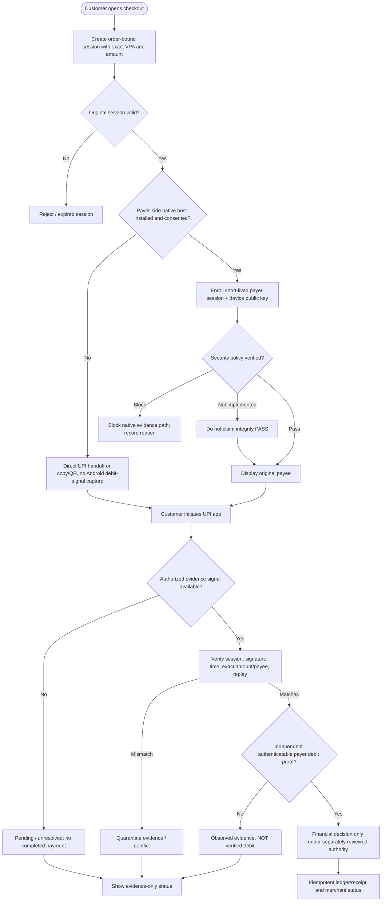

# Client decision flow — target and fail-closed behavior

**Release gate:** Android native launch and notification reading have only synthetic/historical test coverage and require fresh consented real-device validation; bank debit verification must not be inferred from notifications.
