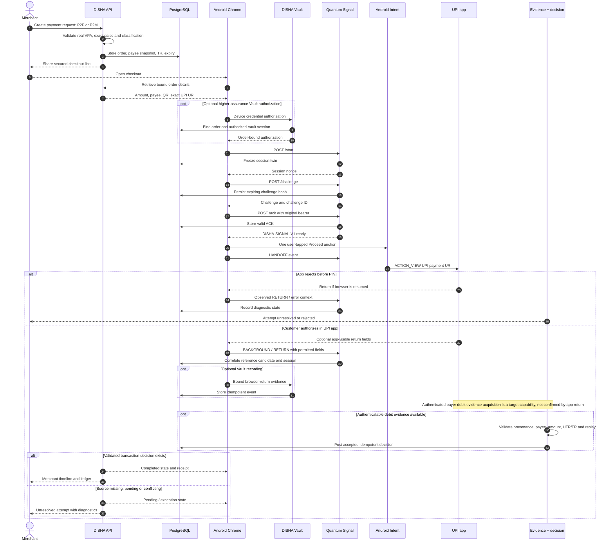
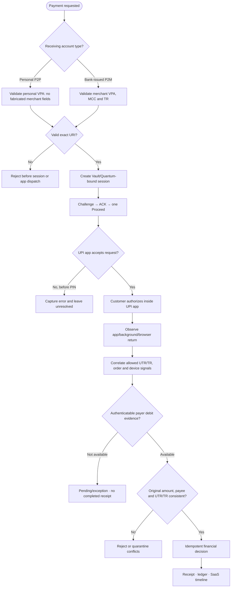

# DISHA 8.2 — End-to-End UPI Journey and Handshake

This is the **target business flow**. The merged `DISHA-SIGNAL-V1` server/browser handshake is implemented, but authentication of a genuine payer-side debit event remains a distinct validation requirement. No bank API, payment aggregator, manual UTR entry or companion app is prescribed.

## Sequence: merchant, Vault, Quantum Signal, UPI app and evidence

## Decision flow

## Exceptions

| Case | Expected handling |
| --- | --- |
| No UPI app installed | Keep scannable QR and safe retry |
| App opens then refuses before PIN | Record error; no completion |
| Customer cancels / wrong PIN | No completed decision |
| Browser backgrounded and never resumes | Persist observed handoff only |
| UTR absent on return | Explicit `RETURN_OBSERVED_NO_UTR` |
| Different UTRs or duplicate UTR across orders | Conflict/quarantine; no duplicate journal |
| Server challenge expires | Reject stale ACK; request fresh checkout |
| Customer scans QR using another phone | Original browser monitors same order state |
| Real payer debit evidence unobtainable | Unresolved, not automatically successful |

## Business UX

A merchant views **Payment, amount, customer-facing transaction reference where actually available, state and evidence timeline**. Raw order, journal, tenant and internal test IDs remain strictly operational identifiers in the service/database and must not appear as product-branded payment references.

See [architecture and interfaces](SYSTEM-ARCHITECTURE.md) and [test plan](TEST-AND-RELEASE.md).
