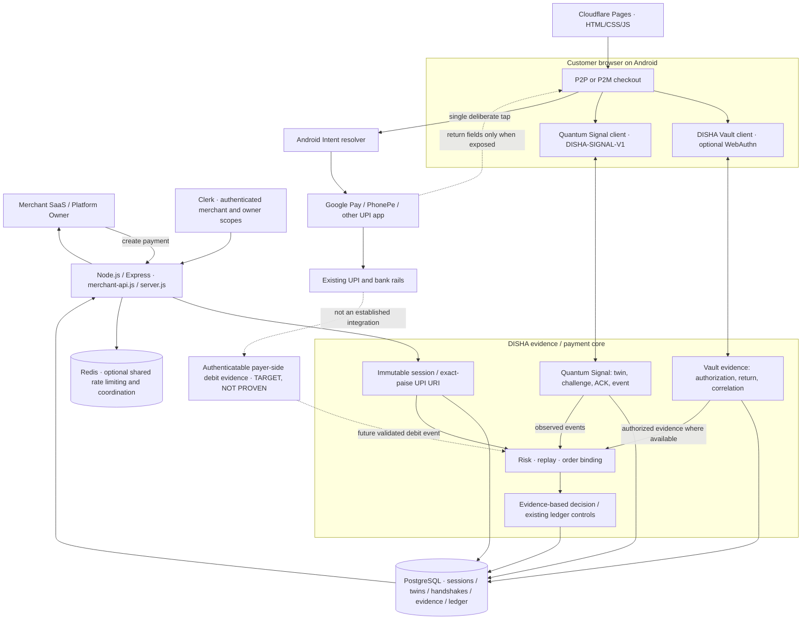

# DISHA 8.2 — Technical Design Document (TDD) and Interface Design Document (IDD)

**Architecture baseline:** 19 November 2026, with Android evidence status refreshed 21 November 2026 (PRs #98–#100 merged) · **Real bank-debit and end-to-end checkout release: NOT VERIFIED**.

This is the canonical engineering design for DISHA 8.2: a merchant-controlled direct UPI checkout with order-bound Vault evidence, Quantum Signal session handshake, payer-side debit-evidence correlation as a target capability, risk controls and audited transaction decisions. No payment aggregator, PSP or bank API, payment-app API, manual UTR entry or external settlement webhook is required for the proposed debit-observation journey. The optional Android evidence mode **does** require an installed DISHA Android component, separately granted system notification-listener access and explicit short-lived user consent; the web-only route cannot read other apps' notifications.

## 1. Product and boundaries

The merchant owns the receiving UPI account and checkout. DISHA issues a specific P2P or P2M payment request, preserves its original amount/payee/reference, establishes an acknowledged session channel, opens the payer's chosen UPI app, correlates observable return signals and attempts to classify the underlying debit event. DISHA is software around existing UPI rails; it cannot command a third-party UPI app or read the payer's private bank state merely because a browser handshake succeeded.

**Current evidence (21 November 2026):** Quantum Signal authenticates browser/session continuity, not a bank debit. PR #98 verified a synthetic Android Credential Manager selector and provider callback on Pixel API 37 / Chrome 145. PR #99 verified consented **synthetic** Android notification → Keystore-signed local session-evidence delivery. PR #100 added a strict labelled UTR/RRN parser but did **not** capture any real debit RRN/UTR; the Pixel had no eligible payer app. The full biometric/permission/consent/copy/I Paid/evidence modal/callback integration and financial source authenticity remain unverified. [Detailed test matrix](DEBIT-FIRST-CHECKOUT-EVIDENCE-STATUS-2026-11-21.md).

## 2. System architecture — current + proposed boundary

The dashed debit-evidence interface is a **design requirement**, not an existing bank/PSP API connection or a claim of proven customer debit.

## 3. Component ownership and code map

| Responsibility | Canonical implementation | Contract |
| --- | --- | --- |
| Public P2P / P2M routes | `server.js` | `/p2p`, `/p2m`, `/p2m/checkout`; modes must not be silently swapped |
| Merchant onboarding / payments | `merchant-api.js` | Clerk-authenticated tenant; active receiving VPA; exact merchant classification |
| UPI URI validation | `utils/upi-intent.js`, `public/cosmic-checkout-model.js` | Immutable `pa`, `pn`, `am`, `cu` and actual merchant `mc`/`tr` |
| Browser checkout | `public/cosmic-checkout.js` | Native user-gesture anchor; order-bound browser status |
| Device Vault | `public/one-touch-vault.js`, `financial/vault-evidence.js` | Optional passkey authorization and bound observed evidence |
| Quantum Signal | `public/quantum-signal-client.js`, `financial/quantum-signal.js` | `/start` → `/challenge` → `/ack` → `/event`; 30-second challenge |
| Risk and claims | `utils/trust-score.js`, `financial/untrusted-utr-claims.js` | Event classification, conflicting return fields and replay detection |
| Android credential fixture | `tests/android/credential-holder-fixture/` | Synthetic credential selector/callback proven; research no-payment exception retained |
| Android notification evidence | `PaymentObservationListener.kt`, `SessionObservation.kt`, `DebitNotification.kt` in fixture; `financial/session-evidence.js` | Consented synthetic signed device events; strict RRN/UTR parser unverified on real debit notifications |
| Financial state | `financial/postgres-store.js` and existing financial modules | Transactional, tenant-bound, idempotent journal/receipt decisions |
| Owner / merchant UI | `public/premium-dashboard.js`, `public/platform-console.js` | No generated internal IDs shown as human-facing payment reference |
| Edge frontend | `public/_worker.js`, `wrangler.toml` | Static checkout + authenticated server API proxy |
| Generated frontend copies | `dist/`, `disha-cinematic/public/`, `disha-cinematic/dist/` | Build parity until deployments are migrated |

## 4. Integration design (IDD)

### P2P and P2M contracts

- **P2P:** personal UPI account, `pa`/`pn`/`am`/`cu`; do not invent merchant MCC, merchant reference or acquirer identity.
- **P2M:** bank-registered merchant payee, validated bank-issued MCC, stored unique `tr`; keep exact `tr` and payee snapshot across reload or VPA edits.
- **Shared:** amount in integer paise internally; exact displayed amount; single payment session; three-minute checkout window; privacy-preserving status. `paymentRef` and checkout bearer token are transport identifiers, not payer-facing product names.

### Quantum Signal API and security

| Endpoint | Purpose | Expected condition |
| --- | --- | --- |
| `POST /api/quantum-signal/start` | Bind caller to immutable order twin | Original checkout token; optional valid Vault session |
| `POST /api/quantum-signal/challenge` | Issue 30-second unpredictable challenge | Matching order, token, nonce and expiry |
| `POST /api/quantum-signal/ack` | Acknowledge challenged session | Exact challenge, correct session, no cross-order reuse |
| `POST /api/quantum-signal/event` | Record handoff / background / return | ACK established; unique event ID; bounded permitted fields |
| `GET /api/quantum-signal/status/:orderId` | Read correlated observations | Access constrained by original session |

This is a **browser ↔ DISHA server** handshake. Its ACK is not equivalent to acknowledgement from Google Pay, PhonePe or a bank.

### Vault, evidence and ledger boundaries

The Vault's optional WebAuthn path authorizes the device-mediated handoff and records observations using `POST /api/vault/evidence`. Return fields such as `txnId` and `ApprovalRefNo` are candidate data, checked for format, order, amount, payee, collisions and replay. The separate decision boundary must reject fabricated success, mismatches and double posting. Validated payer debit evidence is the product target; do not change settled financial states using merely a return parameter or browser timing.

### Technology stack and deployment

**Checkout:** HTML5, native browser JavaScript, CSS, QR assets, browser APIs, optional WebAuthn, lazy 3D presentation. **Backend:** Node.js/Express, merchant APIs, platform authorization, risk/financial modules. **Identity:** Clerk for merchant/owner. **Persistence:** PostgreSQL authoritative for durable sessions/evidence/accounting; optional SQLite development fallback. **Coordination:** Redis optional/shared. **Edge:** Cloudflare Pages/Worker proxy. **Runtime:** Railway deployment configuration. **Tests:** Node.js contract suites, disposable PostgreSQL CI, Android API 35/37 fixture, physical Android UAT. **Automation:** n8n only after release gating, off the synchronous payment path.

## 5. Operational and data invariants

1. Payment URI and bank-facing `tr` must not change after issuance.
2. P2P and P2M classification must be explicit and validated before app dispatch.
3. No frontend action or mock fixture posts a financial completion.
4. Quantum challenge, ACK, browser handoff and app return remain distinct recorded states.
5. Vault event IDs and UTR bindings resist replay and cross-order collision.
6. Cross-tenant merchant access is server-enforced; hidden UI IDs alone are not security.
7. Production UI displays business labels and actual UTR/TR where available, not generated database row IDs.
8. No synthetic merchants, sales, customer receipts, settlement totals or production status.
9. A missing authenticatable debit observation produces **unresolved**, not invented **completed**.
10. Database schema and old financial records cannot be dropped without read-only inventory, backup, dependent-consumer analysis and explicit data-clearing approval.

## 6. Release decision

`npm run lint`, `npm test`, PostgreSQL financial invariants, triad/Android contracts and production frontend mirror tests are necessary but insufficient. Also require: real Google Pay/PhonePe P2P and P2M reaching or correctly rejecting before PIN, real authorized debit-evidence provenance, genuine receipt/ledger invariants, mobile accessibility and SaaS Clerk/tenant tests. A green test receiver does not move money.

See [end-to-end journey](END-TO-END-FLOW.md), [test plan](TEST-AND-RELEASE.md) and the repository's [Ponytail cleanup tracker](https://github.com/Tashima-Tarsh/Zero-Trust-Fintech/issues/69).
