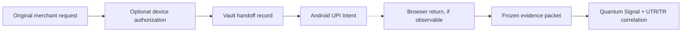

# DISHA Vault

**Your payment attempt, its trust session and its observed return — connected to one original merchant order.**

Vault keeps a recoverable, order-bound evidence history using the existing browser and, when chosen, a platform credential. The higher-assurance WebAuthn option is separate from the default Quantum Signal session-only preflight. Neither requires a merchant-side notification reader, a payer companion application or disclosure of a UPI PIN.

A valid Vault authorization establishes the intended device/session relationship. Validation of the actual payer debit remains a separate evidence task.

[Vault technical architecture](Vault-Architecture.md) · [Quantum Signal sequence](../architecture/END-TO-END-FLOW.md).
