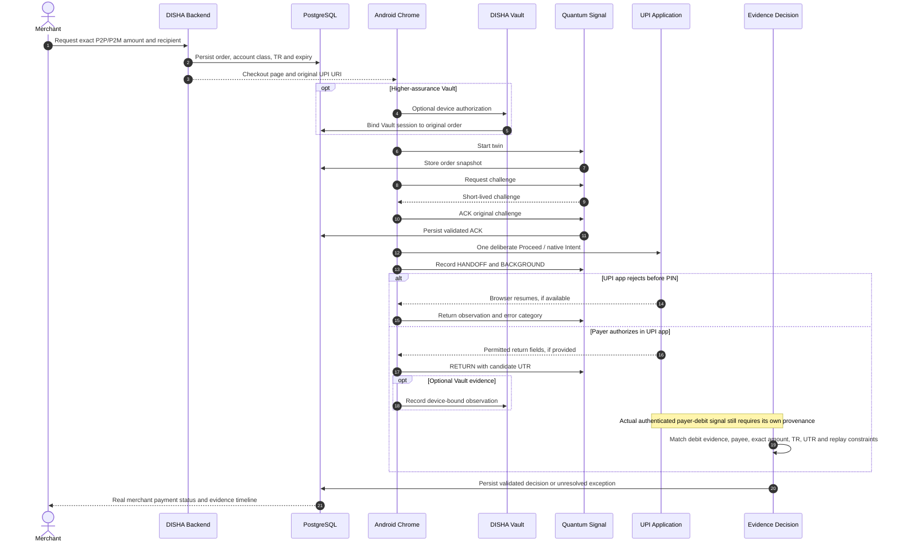

# DISHA 8.2 — End-to-End Payment Journey

The system is designed around **payer-side debit evidence, order-bound Vault records, Quantum Signal ACK and UTR/TR correlation**—not a conventional payment-aggregator hosted checkout.

## Final decision rule

- **Completed:** independently authenticatable payment outcome, correct payee/amount/reference, no replay, accepted by the transaction state machine.
- **Pending / exception:** source not available, app returns without a reference, event conflict, expiry or incomplete proof.
- **Failed:** reported rejection or an observed matching terminal failure, without a fabricated completed ledger state.

Browser return is an event in DISHA's trust timeline; it must not be confused with independently authenticated payer debit.

The detailed sequence, decision tree and every exception are maintained in [the canonical Mermaid flow](../architecture/END-TO-END-FLOW.md).
