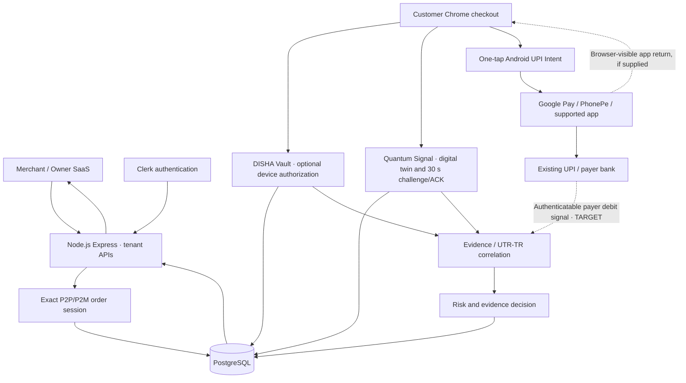

# DISHA 8.2 — Platform Architecture

*The payer's bank and UPI app move money through existing rails. DISHA supplies an independent merchant-controlled checkout and a distinct session/evidence correlation layer.*

## System map

## Stack and deployment boundaries

| Area | Active implementation |
| --- | --- |
| Cloudflare Pages/Worker | `public/_worker.js`, `wrangler.toml`, canonical `public/` assets |
| Checkout | HTML/CSS/JavaScript, native Android Intent and original `upi://pay` QR |
| API and service | `server.js`, `merchant-api.js`, `platform-control.js` |
| Trust and evidence | `financial/vault-evidence.js`, `financial/quantum-signal.js` |
| Identity | Clerk merchant/owner authentication |
| Storage | PostgreSQL for persistent sessions, twin, events, financial state |
| Shared coordination | Redis where configured |
| Deployment | Railway backend, Cloudflare static edge |
| Testing | CI contracts, disposable PostgreSQL, Android test receiver and physical UAT |

## Product rules

The customer experience should require **one Proceed** after the session is prepared, not a mandatory separate app, notification reader or UTR form. P2M must use real merchant classification; P2P must not fabricate it. The customer-facing UI should not expose internal row, journal or tenant IDs as branded payment references.

**Current limitation:** DISHA's browser/server challenge cannot attest to a bank debit by itself. The validated payer-debit data path remains a distinct feature gate. The old financial implementation has to be reconciled in a separate versioned migration, not renamed away.

See [canonical TDD and IDD](../architecture/SYSTEM-ARCHITECTURE.md).
