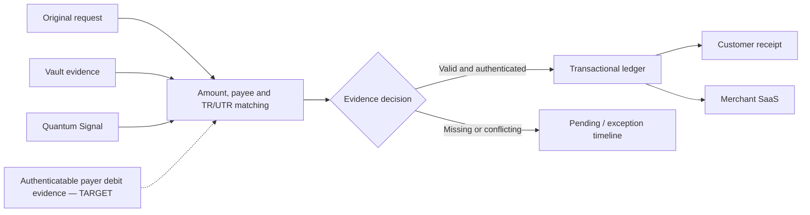

# Transactions, Evidence Decisions, Ledger and Receipts

DISHA's intended innovation correlates **payer-side debit evidence**, the original merchant instruction, Quantum Signal challenge/ACK, Vault evidence and **UTR/TR**, then makes a durable transaction decision.

## Three distinct records

| Record | Purpose |
| --- | --- |
| **Payment instruction** | Real VPA, personal P2P or bank-issued P2M, exact amount, expiration and preserved TR |
| **Trust and evidence timeline** | Vault authorization where provided, Quantum Signal twin/ACK, app handoff, return and allowed UTR candidates |
| **Transaction decision and journal** | Outcome accepted by an audited evidence gate, stored idempotently, represented in merchant reporting |

## Critical implementation distinction

The current repository still contains an older separately authenticated financial reconciliation path. It must not be described as proof that the proposed debit-evidence channel is already live. Replacing the old accounting decision requires an audited, versioned implementation and evidence-source verification; it is not achieved by replacing vocabulary in Markdown.

Customer receipts must never be generated from a debug flag, an emulator fixture, an unchecked UTR string or an app's return alone. Both paid and unresolved states should remain visible and intelligible without showing internal database row IDs.

See [TDD/IDD](../architecture/SYSTEM-ARCHITECTURE.md) and [testing gates](../architecture/TEST-AND-RELEASE.md).
