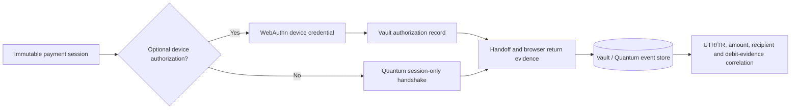

# DISHA Vault — Device, Order and Evidence Architecture

**Vault is the order-linked memory of the customer payment journey. It is not a stored-money wallet.**

## Responsibilities

1. **Order binding:** connect an optional verified device credential to the original payment and session.
2. **Handoff recording:** capture the exact payment attempt, selected app and observable browser lifecycle.
3. **Evidence envelope:** store frozen, deduplicated packets, allowed returned reference candidates and timestamps.
4. **Signal correlation:** provide Vault-bound observations to Quantum Signal's transaction context.
5. **Privacy:** never request customer PIN, read other apps' private screens, or manufacture unseen transaction fields.

**Implementation:** `public/one-touch-vault.js` and `financial/vault-evidence.js`. Quantum Signal is `public/quantum-signal-client.js` and `financial/quantum-signal.js`. The session-only mode does not automatically create a verified WebAuthn credential, and the browser cannot inspect the bank app's internal payment decision.

Full design: [TDD/IDD](../architecture/SYSTEM-ARCHITECTURE.md). Tests: [release plan](../architecture/TEST-AND-RELEASE.md).
