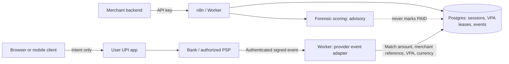

# Architecture and trust boundaries

## Session lifecycle

1. Merchant backend requests a session with an idempotency key (merchant_id + merchant_reference).
2. Database transaction takes an advisory lock and leases one healthy **enabled** merchant-owned VPA using `FOR UPDATE SKIP LOCKED`.
3. Session begins as `PENDING` and expires after 10 minutes. VPA leases have the same TTL.
4. Optional screenshot/behavioral clues are scored **separately**; clients cannot transition a session to paid.
5. Only an authorized provider event with a correct HMAC and exact matching identifiers, currency and amount can move PENDING to PAID. Production must cross-check credited funds through the actual PSP/bank API before performing this transition.
6. Expired sessions never auto-settle. A verified late credit requires an explicit reconciliation process.

## Threat controls

Secrets never enter client bundles; n8n editor and webhooks must be access-controlled; all durable event IDs are deduplicated; mismatched callbacks are rejected; avoid raw biometric collection or persistent device identifiers; store only minimal consented signals; encrypt and rotate keys for production; monitor pool exhaustion, replay attempts, and anomalous event rates.

**Limitation:** the included provider-event endpoint is a local integration scaffold, not a verified real-money bank feed. Do not enable live fulfillment from it until an authorized PSP integration is complete.
