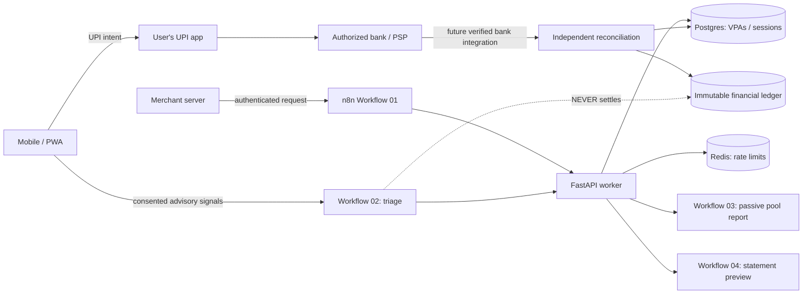

# Architecture

## Core invariants
1. Merchant-scoped VPA leasing is atomic; default 10-minute lease.
2. New sessions are pending, never paid by client return.
3. Forensic results do not authorize transfer, fulfillment or a ledger posting.
4. The mock provider-event adapter verifies HMAC transport but marks success as `awaiting_bank_reconciliation`, never PAID.
5. A durable financial ledger supports append-only debit/credit entries; no postings occur without independently verified credited funds. PostgreSQL triggers reject update/delete.
6. Rate limiting defaults to deny on Redis errors.
7. 1,000 seeded sandbox VPAs are **disabled**, **fictional**, and may not receive money.
8. Mobile identifiers are ephemeral; no device fingerprinting, silent screenshot harvesting, SMS reading or package spoofing.

## Production architecture still required
Integrate verified bank/PSP account credentials, bank-side credit verification, chargebacks/reversals, account ownership checks, approved VPA onboarding, transport mTLS, strict tenant auth/permissions and HTTPS termination. n8n orchestration and its credential store should remain inaccessible to payment clients.

## Native constraints
Android may expose the selected handler, not a guaranteed receiving PSP package. Android 14+ MediaProjection requires user consent per session, and protected windows can block capture. PixelCopy only copies **this application's own** window; it cannot verify what a separate UPI app showed. Package certificate hashes need independently sourced, current, signed allowlists; client reports are untrusted.
